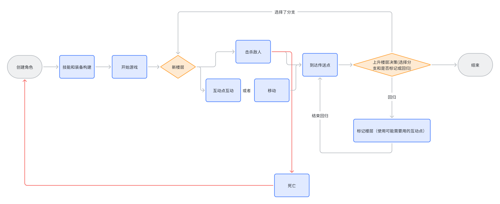
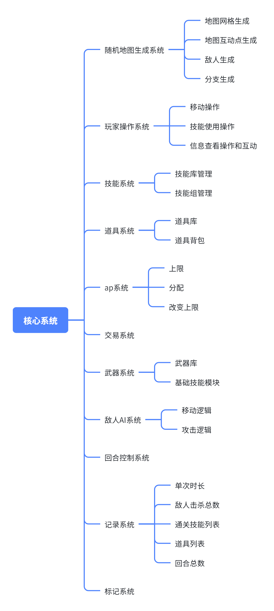
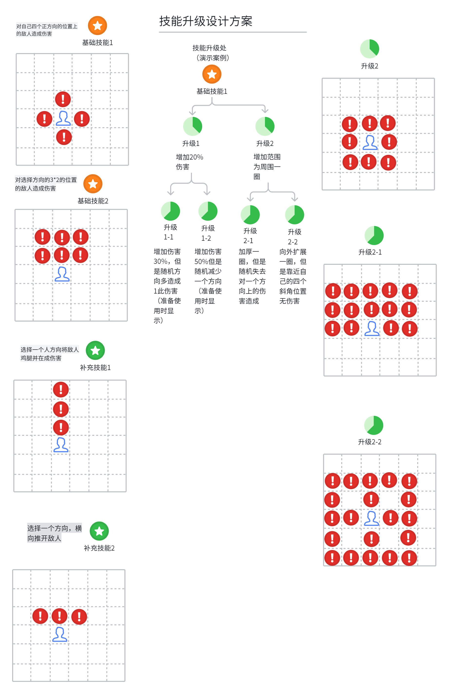
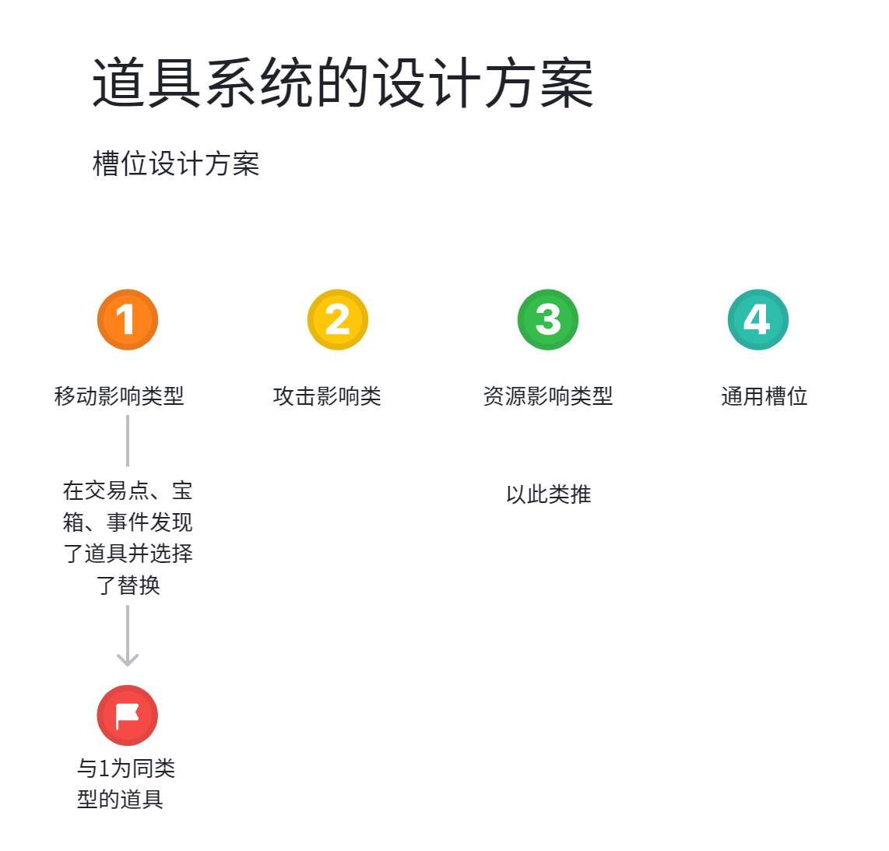
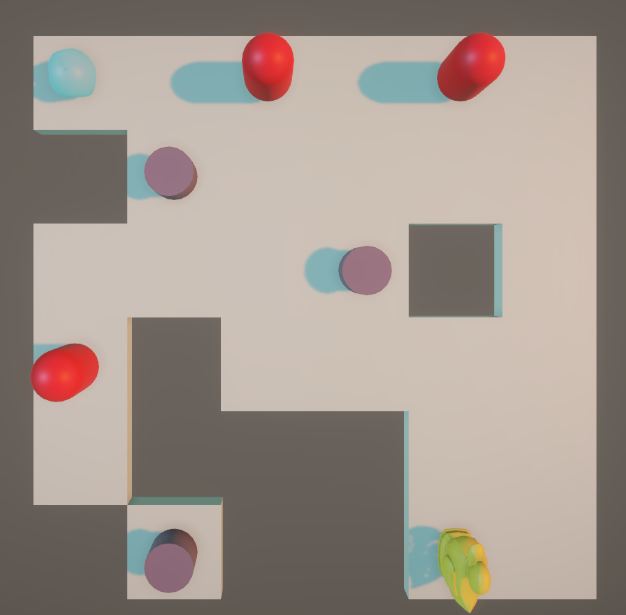
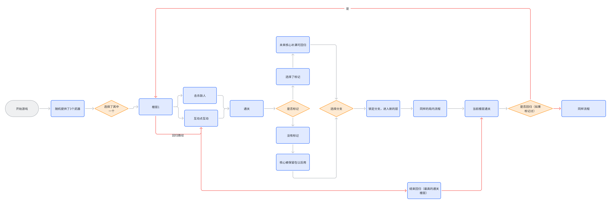

# 《天塔战棋》系统策划案

## 一、简介

本作《天塔战棋》由温宏远担任制作人，是一款 Roguelike 回合制战棋游戏，使用 Unity 引擎开发，面向 PC 键鼠平台，单局时长控制在 30–45 分钟左右。本案为 DEMO 阶段系统策划案，正文中标注【暂定】的条目为待验证参数，标注【待定】的条目为需与前作方案对齐的设计项，均将在实装后收敛。


---

## 二、核心玩法

一款 Roguelike 回合制战棋游戏。玩家每回合拥有有限行动力（AP），在网格上走格子、放技能清怪，把楼层标记下来未来回来补充资源，用技能与道具组出自己的流派，一路向上通关天塔。

一句话概括：**走格子放技能清怪，标记楼层未来回来补充，技能道具组流派。**

---

## 三、核心体验

* **文化体验**：传播游戏梗文化，能够激起懂梗的人的共鸣。
* **决策体验**：构筑决策、路径决策、攻击决策、楼层标记决策。
* **数据体验**：直观的数据反馈带来的刺激。

四种决策体验分别对应后面四个系统的详细设计：构筑决策 → 技能系统 + 道具系统；路径决策 → 操作系统 + 随机地图生成系统；攻击决策 → 回合控制系统 + AP 系统 + 敌人 AI 系统；楼层标记决策 → 楼层决策与标记系统。

---

## 四、核心定位

| 维度 | 定位 |
| --- | --- |
| 目标用户 | Roguelike 玩家，喜欢构筑与决策 |
| 核心乐趣 | 构筑乐趣、决策体验、数据体验 |
| 差异化 | 楼层标记回归机制 + 武器技能强绑定 + 流派构筑 |

三个差异化点在本案中各自对应一个主系统：楼层标记回归机制对应「楼层决策与标记系统」，武器技能强绑定对应「武器系统 + 技能系统」，流派构筑对应「AP 系统 + 道具系统 + 流派构筑」。

---

## 五、核心循环



蓝底矩形为过程节点，橙底菱形为决策节点，红线为死亡与失败回路。

主循环链路：**创建角色 → 技能和装备构建 → 开始游戏 → 新楼层 →（击杀敌人 / 互动点互动 / 移动）→ 到达传送点 → 上升楼层决策 → 结束**。

三条支路说明：

1. **战斗支路**：新楼层后，玩家在同一层里自由安排击杀敌人、互动点互动和移动，三者之间没有强制顺序，只要 AP 够就能一直做，直到清完怪走到传送点。
2. **死亡支路**：任意时刻血量归零即触发死亡，直接回到创建角色，本局的所有构筑全部作废，这是 Roguelike 的局间重置。
3. **楼层决策支路**：到达传送点后进入本作最核心的决策点——选择新分支继续向上，或者回归到已经标记过的楼层。选择分支后回到「新楼层」，回归则进入「标记楼层（使用可能需要用的互动点）」，用完互动点后结束回归、回到传送点继续推进。

---

## 六、核心系统



核心系统共 11 个模块，按职责分为三层：

| 层 | 系统 | 职责 |
| --- | --- | --- |
| 规则层 | 回合控制系统、AP 系统、玩家操作系统 | 定义一局游戏怎么进行、每回合能做什么 |
| 内容层 | 技能系统、道具系统、武器系统、敌人 AI 系统、交易系统、标记系统 | 提供构筑素材与对抗对象 |
| 支撑层 | 随机地图生成系统、记录系统 | 生产关卡内容、沉淀数据反馈 |

依赖关系上，随机地图生成系统最先跑（在关卡 Start 阶段产出网格、互动点、敌人、分支四份数据），回合控制系统是运行时的总调度，AP 系统是所有行为的唯一成本来源，其余系统都通过事件与它通讯。

---

## 七、系统详细设计

### 7.1 回合控制系统

**设计目的**：把"能走几步、能打几下"这件事从隐性规则变成显性资源，让玩家的每一格移动都可以被计价，从而让路径决策和攻击决策共享同一个成本池，形成真正的取舍。

#### 7.1.1 回合流程

玩家回合内消耗 AP 行动，玩家主动结束回合后，敌人按照顺序表进行移动和攻击，所有敌人行动结束后玩家回合开始。

```
玩家回合开始 → AP 补满 → 玩家消耗 AP 行动（移动 / 技能 / 互动）
   → 玩家主动结束回合 → 敌人按顺序表逐个行动 → 全部行动完毕 → 玩家回合开始
```

#### 7.1.2 敌人顺序表

敌人不是同时行动，而是按顺序表逐个结算。顺序表在楼层生成时确定，本 DEMO 阶段按敌人的生成顺序排列，不做速度值排序【暂定】。

采用顺序表而非同时结算的原因：同时结算时，玩家无法预判"我先动还是它先动"，路径决策会退化成赌博；顺序表让玩家在结束回合前就能推演出完整的敌方回合，把决策变成可计算的题。

#### 7.1.3 边界与约定

* 玩家回合内 AP 未用完不自动结束回合，必须由玩家主动点击结束，保留"省 AP"这一层决策。
* 敌人行动期间玩家不可插入操作。
* 玩家血量归零的瞬间即中断当前流程，进入死亡结算，不再继续敌方顺序表。

---

### 7.2 AP 系统

**设计目的**：AP 是本作唯一的行动货币，把移动、技能、道具触发全部折算成 AP 消耗，构筑的强度差异最终都表现为"一回合能换出多少有效输出"。

#### 7.2.1 上限

上限暂时设定为 **6**，每回合补满。

#### 7.2.2 分配

移动、技能消耗 AP。为基础技能和补充技能分别设计 AP 消耗大小，消耗值与技能的作用范围、伤害量成对应关系——范围越大、伤害越高的技能 AP 消耗越高，玩家因此在"多打一小下"和"少打一大下"之间做选择。

移动消耗按格计价，每移动一格消耗 1 AP【暂定】。

#### 7.2.3 改变上限

道具可以改变 AP 的获取规则，而不是简单加数值。已确定的触发方式：

| 触发类型 | 示例 |
| --- | --- |
| 周围状态触发 | 周围 N 格内敌人总数达到 M 时，为玩家多提供 1 AP，每回合激活一次【暂定】 |
| 击杀触发 | 击杀敌人时返还 / 增加 AP |
| 受击状态触发 | 敌人回合结束时若玩家未受到伤害，触发下次回合的 AP 增加 |

第一类正是激进流派的 AP 来源：贴到敌人堆里反而行动更多，用风险换行动频率。

---

### 7.3 玩家操作系统

**设计目的**：尽可能地让玩家只需要操作鼠标就能完成大部分操作。那么，就要分离各个操作方法，让鼠标操作能在不同环境中有不同的操作结果。

#### 7.3.1 操作优先级

UI 操作 > 移动操作 >= 技能使用操作

#### 7.3.2 实现方法

UI 图层自然覆盖在游戏界面上，处于最高图层，部分次级 UI 通过按键来隐藏和激活，减少 UI 对游戏画面的遮挡。

移动操作涉及网格移动，限制玩家从角色的最近一格地块作为起始点，按下拖动来绘制移动轨迹。这样有效地将选择操作与移动操作隔开——因为选择操作必定是指定非可移动地块的对象，那么就不会出现玩家选择操作时却执行移动操作。并且这两种操作都简化到只使用鼠标左键，右键可取消这两种操作。

三项操作的对应关系：

| 操作 | 输入 | 反馈 |
| --- | --- | --- |
| 移动操作 | 从角色相邻格按下拖动，绘制轨迹后松开 | 轨迹经过的格子高亮，并实时显示总 AP 消耗 |
| 技能使用操作 | 点击技能图标，再点击目标格 / 方向 | 显示技能作用范围，范围内敌人高亮 |
| 信息查看操作和互动 | 悬停或点击敌人、互动点 | 弹出信息面板；互动点则进入交互界面 |

> 拖动绘制轨迹这一交互沿用前作方案，本作需额外验证：在斜向移动类道具生效后，拖动轨迹的形状规则要同步改写。【待定】

---

### 7.4 武器系统

**设计目的**：武器不是数值装备，而是技能组的载体。取消自动攻击之后，玩家的进攻手段完全由武器所携带的基础技能决定，因此武器选择等于开局流派选择。

#### 7.4.1 武器库

当前只先设计 **3 种**武器，未来增加。

#### 7.4.2 基础技能模块

每把武器自带 **2 个基础技能**作为进攻手段，与武器形成强绑定。

#### 7.4.3 开局选择

在一局游戏开始时，系统为玩家随机分配 2 种武器让玩家选择其中一个【PPT 表述为"随机分配 2 种武器让玩家选择"，具体是 2 选 1 还是 3 选 1 待与流程图统一，见文末待确认项】。

---

### 7.5 技能系统

**设计目的**：技能是本作唯一的攻击手段（已取消原设计的自动攻击机制）。通过"基础技能锁死、补充技能可换、升级树分叉"这三层结构，让玩家在有限的槽位里做出有代价的构筑决策。

#### 7.5.1 技能库管理

技能库通过列表的方式存放技能的 ScriptableObject 的数据结构脚本，再通过 PlayerData 数据结构直接调用，从而在 PlayerBehaviour 脚本中分配给技能释放方法。

#### 7.5.2 技能组管理

| 槽位 | 数量 | 来源 | 可否替换 |
| --- | --- | --- | --- |
| 基础技能 | 2 | 武器自带 | 不可替换 |
| 补充技能 | 上限 2 | 局内获取（交易点低概率出现） | 可替换 |

补充技能也是根据武器来设计的，保证技能组内部风格统一。

**替换风险**：替换补充技能会丢失该技能已投入的升级进度。这一条是构筑决策的核心张力所在——设计原因就是像小丑牌的小丑牌槽位一样，玩家在"要留还是换"之间做抉择。

#### 7.5.3 技能升级设计



技能示例（演示用）：

| 技能 | 效果 |
| --- | --- |
| 基础技能 1 | 对自己四个正方向的位置上的敌人造成伤害 |
| 基础技能 2 | 对选择方向的 3×2 的位置的敌人造成伤害 |
| 补充技能 1 | 选择一个人方向将敌人鸡腿并在成伤害 |
| 补充技能 2 | 选择一个方向，横向推开敌人 |

升级的设计跟着技能的特性做成树形结构来扩展。以基础技能 1 为例，升级路线分为**对范围的升级**还是**对伤害的升级**，这样决定了玩家选择是打伤害为主，还是一次性打更大的面积为主。

升级树结构（演示案例）：

```
基础技能1
├── 升级1  增加 20% 伤害
│   ├── 升级1-1  增加伤害 30%，但是随机方向多造成 1 此伤害（准备使用时显示）
│   └── 升级1-2  增加伤害 50%，但是随机减少一个方向（准备使用时显示）
└── 升级2  增加范围为周围一圈
    ├── 升级2-1  加厚一圈，但是随机失去对一个方向上的伤害造成
    └── 升级2-2  向外扩展一圈，但是靠近自己的四个斜角位置无伤害
```

**升级选择是按照树结构顺序进行，选择了升级 2 则不能去升级 1 的分支。**

树形结构里第二层全部带"随机"副作用，是有意为之：升级不是纯上位的数值奖励，越往深走越要牺牲一部分稳定性换上限，这也直接支撑了精准流派"逐一击杀处理"的玩法——玩家会主动回避带随机的分支。

技能替换后返还升级点数，避免玩家在补充技能槽上做构筑时因沉没成本而不敢换。

---

### 7.6 道具系统

**设计目的**：道具改变核心机制，非数值加成。道具负责打破玩家已经形成的操作习惯，是流派上限的主要来源。

#### 7.6.1 道具效果分类

**规则改变类型**：

| 改变对象 | 示例 |
| --- | --- |
| 移动方式改变 | 联通路径选择变为斜向移动 |
| 敌人行为改变 | 初遇被玩家眩晕 |
| 攻击的效果改变 | 附加流血 |
| 血量规则改变 | 击杀恢复血量 |

**AP 改变**：周围状态触发 AP 增加、击杀触发 AP 增加、敌人回合结束没有受到伤害触发下次的 AP 增加等（详见 AP 系统）。

#### 7.6.2 道具槽位设计



道具按影响对象分为三类槽位 + 一个通用槽：

| 槽位 | 类型 |
| --- | --- |
| 1 | 移动影响类型 |
| 2 | 攻击影响类 |
| 3 | 资源影响类型 |
| 4 | 通用槽位 |

同类道具之间互斥，替换规则为：在交易点、宝箱、事件发现了道具并选择替换，则新道具与槽位内原道具为同类型，直接顶替。

#### 7.6.3 道具品质构想

有个构想就是道具本身存在品质，同一个道具有不同品质（道具的数值，或者类似小丑牌中的负片牌一样来增加槽位），增加构筑替换策略深度，让玩家不只是单纯地对比道具的内容，还能在数值和额外效果上做比较，让流派的上限提高。

#### 7.6.4 其他约定

* 获取途径：商店 / 宝箱 / 事件。
* 道具**不可升级**——升级深度交给技能树承担，道具只负责机制广度。

---

### 7.7 随机地图生成系统

#### 7.7.1 随机地图网格生成

在游戏 Start 生命周期中，系统生成完整 n × n 的网格，根据设定的算法做加减网格处理以及网格的信息处理，最后逐层转为 json 文件保存。



#### 7.7.2 随机敌人生成

获取随机生成地图阶段的 json 信息，通过算法来随机赋予敌人生成的位置信息以及预制体信息，最终保存为 json 文件。

#### 7.7.3 随机互动点生成

排除所有已经被赋予特殊信息的网格，根据算法随机分配可交互的地块，保存为 json 文件。互动点生成后还会随机决定自己是哪一种类型。

#### 7.7.4 分支生成

通关一层后，由分支生成器产出下一层的多个候选分支，并为每个分支携带"敌人、互动点类型"两类信息，供玩家在传送点做楼层决策。

其他特殊信息地块（传送点等）的处理方案都按照这套逻辑。

---

### 7.8 楼层决策与标记系统

**设计目的**：Roguelike 的分支选择通常是"选了就没了"，这让决策变成一次性的赌博。本作把楼层变成可回访的资源，让玩家能够为未来做计划，把决策从赌博变成投资。

#### 7.8.1 楼层决策

通关一层后，提供新楼层分支，为玩家提供每个分支楼层的信息（敌人、互动点的类型）——参考哈迪斯的每次通关可以从门上面看到下一关能够提供什么奖励。**选择分支后就直接锁定，未来回归也不会再提供其他分支。**

可见信息只有当前这一层，玩家无法预测未来的分支，这是下面这条保底机制成立的前提。

#### 7.8.2 楼层可回归机制

楼层回归机制作为一种**保底机制**，玩家可以选择回到已经通关的楼层，解决因为资源问题而造成的玩家分支决策的结果不够理想的问题。

典型场景：选择了有交易的分支，进入交易点互动时发现有特别想要的道具或者技能，但实际上金额不够。那么保底机制就生效了——未来玩家可能很少见到新的交易点了，但是资源囤积上来了，就能够通过回归来弥补，让玩家的游戏推进更有信心。

那么问题来了，玩家为什么不选分支的时候就想好呢？因为玩家只能看到当前的下个分支，玩家无法预测未来的分支，而且这样做相当于支援未来。玩家当然可以在没有资源的时候仍然选择有交易点的分支来支援未来，也可以在没有组好技能的时候选有技能升级的分支来支援未来的技能升级；就算未来仍然没有找到，也可以回来把现有的给升级，来为玩家的推进保底，给玩家带来**计划成功**的体验。

#### 7.8.3 标记规则

* 通关一层后，玩家决定是否**标记**该层。
* 被标记的楼层及其互动点状态保留，未来可通过传送点回归使用。
* 未被标记的楼层，其核心奖励被保留在以后使用（即该层不再可回访，但资源不会白白浪费）。
* 回归使用完毕后，结束回归，回到最高的通关楼层继续推进。

---

### 7.9 互动点系统

**设计目的**：互动点是玩家把货币和楼层信息转化为构筑强度的唯一入口，因此每个互动点的"可重复性"和"消耗性"必须区分清楚，否则玩家会在错误的时机消耗掉关键资源。

| 类型 | 提供内容 | 消耗规则 |
| --- | --- | --- |
| 事件 | 付出代价来获得收益 | 交互后消耗 |
| 交易 | 主要出现道具，低概率出现技能，低概率出现即时低血量恢复、少量血量上限提升、道具品质铸造 | **可反复使用，内容不更新** |
| 宝箱 | 提供道具，以及极低概率同时出现补充技能以及货币 | 交互即消耗，玩家可以选择不接受内容 |
| 升级服务 | 技能升级（树形结构，且只显示已获得的技能的升级树） | 操作使用后失效 |
| 血站 | 免费使用的高额血量恢复或者血量上限提升二选一 | 免费 |

补充约定：

* 互动点在每层自动随机生成后保留在当前层。
* 每个互动点会随机决定自己是其中哪一种。
* 玩家如果只是进入查看而不操作，可以再次打开（升级服务、事件同理）。
* **类型可以通过模型外观来判断**，玩家不需要走近才知道是什么，这是楼层决策能成立的信息基础。

---

### 7.10 敌人与 AI 系统

**设计目的**：敌人是 AP 成本的来源，也是路径决策的障碍。AI 不需要聪明，只需要行为可预测，让玩家能算出敌方回合。

#### 7.10.1 移动逻辑

敌人在自己的行动回合内，按顺序表依次移动，向玩家靠近或执行预设的巡逻路径【暂定，具体规则待 AI 模板实装后确定】。

#### 7.10.2 攻击逻辑

敌人进入攻击范围后对玩家造成伤害。玩家的血量是唯一被攻击的资源，因此卖血流派、肉山流派的构筑都直接挂钩这一环。

#### 7.10.3 受道具影响

敌人行为可被道具改变（例：初遇被玩家眩晕），改变通过规则层注入，不修改 AI 模板本身。

---

### 7.11 交易与货币系统

#### 7.11.1 货币获取

| 途径 | 说明 |
| --- | --- |
| 敌人死亡掉落 | 战斗的直接反馈 |
| 宝箱获取 | 探索奖励 |
| 通关奖励 | 楼层推进奖励 |

#### 7.11.2 交易系统

交易系统挂在交易类互动点上，主要出售道具，低概率出售技能，低概率提供即时低血量恢复、少量血量上限提升、道具品质铸造服务。货架内容在互动点生成时确定，之后**不更新**，可反复访问——这正是楼层标记回归机制最主要的回访理由。

---

### 7.12 记录系统

**设计目的**：数据体验要求"直观的数据反馈带来的刺激"，因此记录系统负责把一局的结果从模糊印象变成可比较的数字。

记录字段：

| 字段 | 用途 |
| --- | --- |
| 单次时长 | 控制节奏，验证 30–45min 的设计目标 |
| 敌人击杀总数 | 反映战斗密度 |
| 通关技能列表 | 复盘构筑，用于流派平衡调参 |
| 道具列表 | 同上 |
| 回合总数 | 与单次时长交叉，定位拖慢节奏的系统 |

通关技能列表与道具列表同时服务于梗文化表达——玩家晒出构筑时，这两份列表就是内容本身。

---

## 八、流派构筑

流派不是独立系统，而是 AP 消耗、技能范围、道具规则三者配比后的涌现结果。设计时以"每个流派都有明确的 AP 使用姿势"为校验标准。

| 流派 | 打法特征 | 主要支撑 |
| --- | --- | --- |
| 纯 AP 流 | 单纯提高行动的频率 | AP 改变类道具 |
| 激进流派 | 拉近作战 | 小范围高伤害技能、周围敌人触发 AP 的道具 |
| 拉扯流派 | 拉远作战 | 远距离 / 大范围小伤害技能 |
| 卖血流派 | 通过受伤换取高额的伤害收益或者货币收益 | 血量规则改变类道具 |
| 精准流派 | 攻击目的为精准地对单个敌人攻击，逐一击杀处理 | 单体高伤技能、回避随机分支的升级路线 |
| 肉山流 | 以高血量上限为成长目的 | 血站的血量上限选项、击杀回血道具 |

其中激进打法与拉扯打法是技能设计时显式对齐的两个方向：小范围但高伤害的技能为激进打法服务，远距离或者大范围小伤害的来服务拉扯打法。

---

## 九、具体流程



单局完整链路：

```
开始游戏 → 随机提供武器 → 选择其中一个 → 楼层1
   →（击杀敌人 / 互动点互动）→ 通关 → 是否标记？
        ├── 选择了标记 → 未来核心补满可回归 ─┐
        └── 没有标记 → 核心被保留在以后用   ─┴→ 选择分支
   → 锁定分支，进入新的层 → 同样的局内流程 → 当前楼层通关
   → 是否回归（如果标记过）？
        ├── 是 → 回归路径回到目标楼层的互动点 → 结束回归（最高的通关楼层）→ 继续推进
        └── 否 → 同样流程，继续向上
```

三个关键控制点：

1. **开局选武器**：决定本局的两个基础技能，即决定流派起点。
2. **每层通关后的"是否标记"**：本作的特色决策，把楼层变成未来的资源。
3. **传送点的"是否回归"**：保底机制的兑现点，解决资源不足导致的构筑卡死。

单局时长控制在 **30–45min** 左右。

---

## 十、艺术风格

| 层 | 风格 | 参考 |
| --- | --- | --- |
| 模型（DEMO 阶段） | 低精度单色几何棋子建模，未来使用体素模型 | SuperHot |
| 建筑 | 体素化风格建模 | — |
| UI | 像素风格 | 王之凝视 |


低精度单色几何 + 像素 UI 的组合还有一个附带收益：敌人、互动点、传送点、玩家四类对象必须靠色块与轮廓区分（关卡草图中玩家为黄色、敌人为红色、互动点为紫色、传送点为青色），这直接服务于"互动点类型可以通过模型外观来判断"这条设计约定。

---

## 十一、工期安排（单人）

| 周期 | 内容 | 产出 |
| --- | --- | --- |
| W1 | 完成核心系统的框架 | 操作系统、AI 模板、数据模板 |
| W2 | 细化框架功能 | 操作功能、UI 结构 |
| W3 | 框架功能测试、总体 Bug 修改 | 可跑通的框架；时间足够会考虑加入难度调节系统 |
| W4–W6 | 模块功能设计与实装 | 武器 3（当前只先设计三种，未来增加）、基础技能 6、补充技能 15、升级分支 30【数值上的改变和少量的机制提升】、道具 15 |
| W7 | 美术资源制作与接入，音效制作 | 模型资源收集、UI 资源绘制、接入预制体 |
| W8 | 总体效果测试、数据微调 | 可交付 DEMO |

---

## 十二、待确认项

| 编号 | 事项 | 说明 |
| --- | --- | --- |
| 1 | 开局武器候选数 | PPT 正文为"随机分配 2 种武器让玩家选择"，流程图节点为"随机提供了 3 个武器"，需统一。 |
| 2 | 敌人顺序表排序依据 | 当前按生成顺序，是否引入速度值待定。 |
| 3 | 移动 AP 单价 | 每格 1 AP 为暂定值，需与技能消耗一起回归调参。 |
| 4 | 斜向移动道具与拖动轨迹的兼容 | 移动方式改变后，路径绘制规则需同步改写。 |
| 5 | 未标记楼层"核心被保留在以后用"的具体兑现形式 | 流程图有此节点，规则未定义。 |
| 6 | 难度调节系统 | 排在 W3 的可选追加项，未纳入核心系统脑图。 |
| 7 | 道具品质（含负片牌式加槽位） | 目前为构想，未进入 W4–W6 的实装清单。 |
